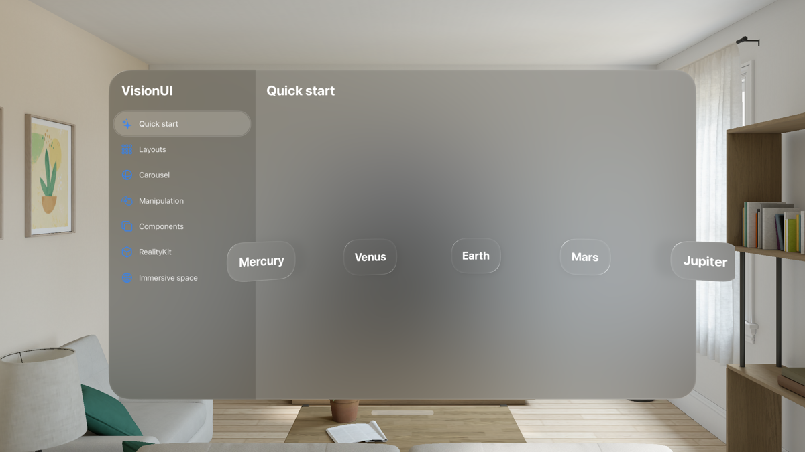
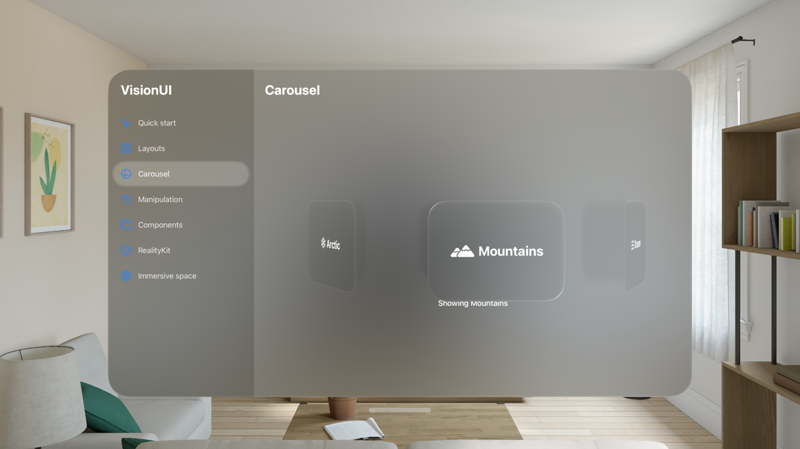
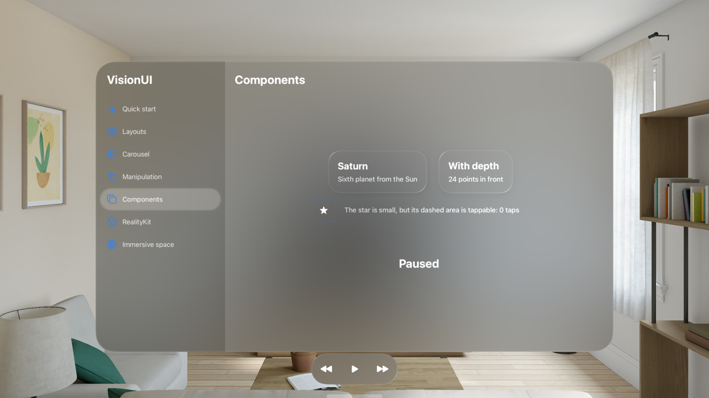
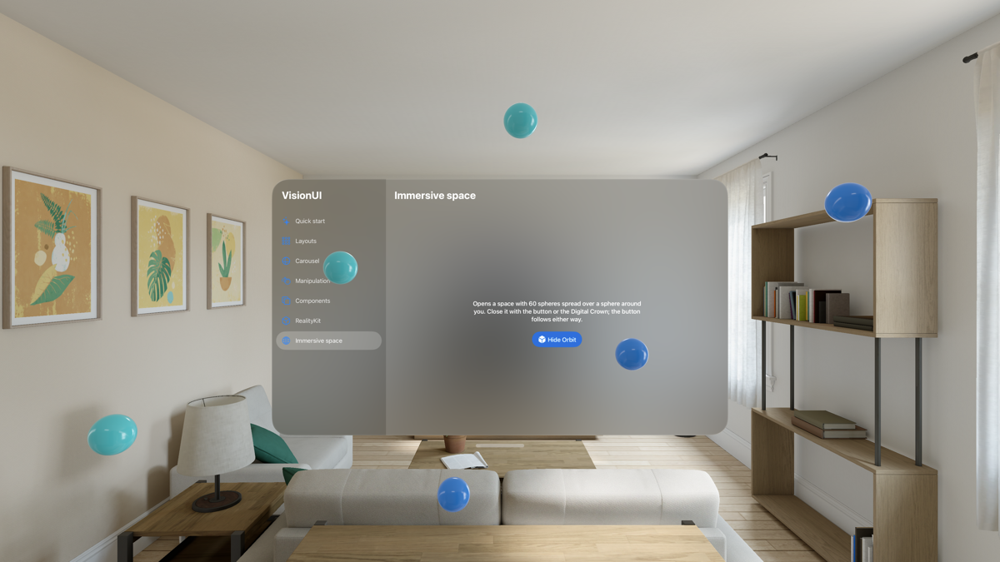
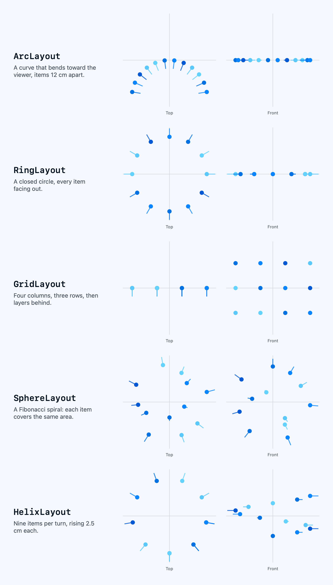

<!-- i18n-source: README.md@a607cdedad0ba713bf27fccccb58208ca691502a status=reviewed -->
<!-- brand:start -->

<p align="center"><picture><source media="(prefers-color-scheme: dark)" srcset="https://raw.githubusercontent.com/muhittincamdali/VisionOS-UI-Framework/main/.github/brand/banner-de-dark.svg"><source media="(prefers-color-scheme: light)" srcset="https://raw.githubusercontent.com/muhittincamdali/VisionOS-UI-Framework/main/.github/brand/banner-de-light.svg"></picture></p>

<!-- lang-selector:start -->
<p align="center"><a href="README.md">English</a> · <a href="README.tr.md">Türkçe</a> · <a href="README.zh-CN.md">简体中文</a> · <a href="README.ja.md">日本語</a> · <a href="README.ko.md">한국어</a> · <a href="README.es.md">Español</a> · <a href="README.de.md">Deutsch</a> · <a href="README.fr.md">Français</a> · <a href="README.pt-BR.md">Português (Brasil)</a> · <a href="README.ru.md">Русский</a></p>
<!-- lang-selector:end -->

<p align="center">
<a href="https://github.com/muhittincamdali/VisionOS-UI-Framework/actions/workflows/ci.yml"></a>
<a href="https://github.com/muhittincamdali/VisionOS-UI-Framework/releases"><picture><source media="(prefers-color-scheme: dark)" srcset="https://raw.githubusercontent.com/muhittincamdali/VisionOS-UI-Framework/main/.github/brand/badge-version-dark.svg"><source media="(prefers-color-scheme: light)" srcset="https://raw.githubusercontent.com/muhittincamdali/VisionOS-UI-Framework/main/.github/brand/badge-version-light.svg"></picture></a>
<a href="https://github.com/muhittincamdali/VisionOS-UI-Framework/blob/main/Package.swift"><picture><source media="(prefers-color-scheme: dark)" srcset="https://raw.githubusercontent.com/muhittincamdali/VisionOS-UI-Framework/main/.github/brand/badge-platforms-dark.svg"><source media="(prefers-color-scheme: light)" srcset="https://raw.githubusercontent.com/muhittincamdali/VisionOS-UI-Framework/main/.github/brand/badge-platforms-light.svg"></picture></a>
<a href="https://github.com/muhittincamdali/VisionOS-UI-Framework/blob/main/Package.swift"><picture><source media="(prefers-color-scheme: dark)" srcset="https://raw.githubusercontent.com/muhittincamdali/VisionOS-UI-Framework/main/.github/brand/badge-language-dark.svg"><source media="(prefers-color-scheme: light)" srcset="https://raw.githubusercontent.com/muhittincamdali/VisionOS-UI-Framework/main/.github/brand/badge-language-light.svg"></picture></a>
<a href="https://github.com/muhittincamdali/VisionOS-UI-Framework/blob/main/LICENSE"><picture><source media="(prefers-color-scheme: dark)" srcset="https://raw.githubusercontent.com/muhittincamdali/VisionOS-UI-Framework/main/.github/brand/badge-license-dark.svg"><source media="(prefers-color-scheme: light)" srcset="https://raw.githubusercontent.com/muhittincamdali/VisionOS-UI-Framework/main/.github/brand/badge-license-light.svg"></picture></a>
</p>

<p align="center">
<a href="#schnellstart"><picture><source media="(prefers-color-scheme: dark)" srcset="https://raw.githubusercontent.com/muhittincamdali/VisionOS-UI-Framework/main/.github/brand/button-start-de-dark.svg"><source media="(prefers-color-scheme: light)" srcset="https://raw.githubusercontent.com/muhittincamdali/VisionOS-UI-Framework/main/.github/brand/button-start-de-light.svg"></picture></a>
<a href="https://muhittincamdali.github.io/VisionOS-UI-Framework/documentation/visionui/"><picture><source media="(prefers-color-scheme: dark)" srcset="https://raw.githubusercontent.com/muhittincamdali/VisionOS-UI-Framework/main/.github/brand/button-docs-de-dark.svg"><source media="(prefers-color-scheme: light)" srcset="https://raw.githubusercontent.com/muhittincamdali/VisionOS-UI-Framework/main/.github/brand/button-docs-de-light.svg"></picture></a>
<a href="https://github.com/muhittincamdali/VisionOS-UI-Framework/tree/main/Examples"><picture><source media="(prefers-color-scheme: dark)" srcset="https://raw.githubusercontent.com/muhittincamdali/VisionOS-UI-Framework/main/.github/brand/button-examples-de-dark.svg"><source media="(prefers-color-scheme: light)" srcset="https://raw.githubusercontent.com/muhittincamdali/VisionOS-UI-Framework/main/.github/brand/button-examples-de-light.svg"></picture></a>
</p>

> Dies ist eine Übersetzung der englischen README. Bei Abweichungen gilt die englische Fassung.

<!-- brand:end -->
Ein Swift-Paket für visionOS-Apps: Es platziert SwiftUI-Views und RealityKit-Entities mit fünf Layouts (Bogen, Ring, Raster, Kugel, Helix) im 3D-Raum, macht aus einem Ring von Views ein Karussell, öffnet und schließt immersive Räume ohne die Race Conditions eines von Hand gepflegten Flags und lässt Nutzerinnen und Nutzer Objekte innerhalb der von dir gesetzten Grenzen verschieben, skalieren und drehen. Es richtet sich an Entwickler, die diese räumlichen Bausteine verwenden möchten, ohne die Geometrie und die Zustandsverwaltung selbst zu schreiben. Derselbe Code läuft auch unter iOS und macOS, wo die Layouts von vorn gesehen gezeichnet werden, und das Paket hat keine Abhängigkeiten.

<p align="center"></p>

## Highlights

- **Fünf räumliche Layouts** — Bogen, Ring, Raster, Kugel und Helix liefern für jedes Element eine Position in Metern und eine Ausrichtung, für SwiftUI-Views mit `SpatialLayoutView` und für RealityKit-Entities mit `arrangeChildren(using:)`.
- **Immersive Räume ohne Race Conditions** — `ImmersiveSpaceCoordinator` lehnt eine zweite Anfrage während eines Übergangs ab, schließt einen Raum, bevor ein anderer geöffnet wird, und folgt dem System, wenn die Person einen Raum mit der Digital Crown schließt.
- **Manipulation innerhalb von Grenzen** — `ManipulationState` hält ein gezogenes, per Pinch-Geste skaliertes oder gedrehtes Objekt innerhalb einer Box und eines Skalierungsbereichs, auf Wunsch aufrecht und mit Einrasten (Snapping), und ignoriert fehlerhafte Gestenwerte.
- **Komponenten in plattformgerechter Größe** — `SpatialCard`, eine Toolbar, die unter visionOS zum Ornament wird, und Trefferflächen in der Größe, die Apples Richtlinien vorgeben (60 pt unter visionOS, 44 unter iOS, 28 unter macOS).
- **Nicht vertrauenswürdige Eingaben sind unbedenklich** — Anzahlen sind auf 4096 Elemente und Längen auf 10 km begrenzt, und NaN oder unendliche Argumente fallen auf dokumentierte Standardwerte zurück. So kann ein aus einer Datei gelesener Wert weder den Speicher aufbrauchen noch eine unendliche Position erzeugen.
- **Auf drei Plattformen getestet** — 94 Swift-Testing-Tests laufen unter macOS und auf einem iPhone-Simulator; 84 davon, alle außer den Pixeltests, laufen auch auf einem visionOS-Simulator.

### Was enthalten ist

| Bereich         | API                                                                                                                              |
| --------------- | -------------------------------------------------------------------------------------------------------------------------------- |
| Layouts         | `ArcLayout`, `RingLayout`, `GridLayout`, `SphereLayout`, `HelixLayout`, `offset(_:)`, `SpatialFacing`                            |
| SwiftUI         | `SpatialLayoutView`, `SpatialCarousel`, `spatialPlacement(_:projection:)`, `FlatProjection`                                      |
| RealityKit      | `Entity.arrangeChildren(using:duration:timingFunction:)`, `Entity.arrange(_:using:relativeTo:)`, `Transform(_:scale:)`           |
| Immersive Räume | `ImmersiveSpaceCoordinator`, `ImmersiveSpaceActions`, `ImmersiveSpaceToggle`                                                     |
| Manipulation    | `ManipulationState`, `ManipulationConstraints`, `SpatialBounds`, `spatialManipulation(_:pointsPerMeter:)`                        |
| Komponenten     | `SpatialCard`, `SpatialToolbar`, `toolbarOrnament(edge:content:)`, `spatialHitTarget(minimum:)`, `spatialDepth(_:)`, `HitTarget` |

## Schnellstart

**1. Paket hinzufügen**

Wähle in Xcode **File › Add Package Dependencies…** und gib die Repository-URL ein:

```text
https://github.com/muhittincamdali/VisionOS-UI-Framework.git
```

Füge sie in das Suchfeld oben rechts im Fenster ein. Lass **Dependency Rule** auf **Up to Next Major Version** ab `2.0.0` stehen und klicke auf **Add Package**. Wähle im nächsten Fenster neben **VisionUI** dein App-Target aus und klicke erneut auf **Add Package**.

**2. Modul importieren**

```swift
import VisionUI
```

Setze diese Zeile an den Anfang der Swift-Datei, in der du das Paket verwendest, unter `import SwiftUI`.

**3. Verwenden**

Ersetze in einer neuen visionOS-App (**File › New › Project… › visionOS › App**) den gesamten Inhalt von `ContentView.swift` durch:

```swift
import SwiftUI
import VisionUI

struct ContentView: View {
    let planets = ["Mercury", "Venus", "Earth", "Mars", "Jupiter"]

    var body: some View {
        SpatialLayoutView(.arc(radius: 0.6, spacing: 0.17), planets, id: \.self) { planet in
            SpatialCard {
                Text(planet)
                    .font(.title)
            }
        }
    }
}
```

Wähle den **Apple Vision Pro**-Simulator und drücke **Run** (⌘R). Die fünf Karten krümmen sich wie im Bild oben zu dir hin: die mittlere in der Ebene des Fensters, die äußeren näher und zum Mittelpunkt des Bogens gedreht, 0.6 m vor dem Fenster. Ändere den Radius auf `0.3` und starte erneut, für eine engere Krümmung. Derselbe Code läuft auch auf einem iPhone oder einem Mac, wo der Bogen von vorn gesehen gezeichnet wird.

## Installation

### Swift Package Manager

Wähle in Xcode **File › Add Package Dependencies…** und gib die Repository-URL ein:

```text
https://github.com/muhittincamdali/VisionOS-UI-Framework.git
```

Oder füge es zu den `dependencies` in deiner `Package.swift` hinzu:

```swift
dependencies: [
    .package(url: "https://github.com/muhittincamdali/VisionOS-UI-Framework.git", from: "2.0.0")
],
targets: [
    .target(name: "YourApp", dependencies: [
        .product(name: "VisionUI", package: "VisionOS-UI-Framework")
    ])
]
```

Version 2.0.0 (Oktober 2026) ist ein neues Paket mit einer neuen API. Das frühere Release 1.0.0 (Februar 2026) deklarierte eine Plattformversion, die es nicht gibt (`.visionOS(.v1_0)`), sodass Swift Package Manager es nicht auflösen konnte, und sein Quellcode rief APIs auf, die es im visionOS SDK nicht gibt. Im Juni 2026 wurde dieser Code durch Platzhalter ersetzt, und im Oktober 2026 wurde das Paket von Grund auf neu geschrieben. [CHANGELOG.md](CHANGELOG.md) listet auf, was sich geändert hat.

## Verwendung

Die folgenden Beispiele sind kopiert aus
[`Examples/SpatialGallery/SpatialGallery/ReadmeSamples.swift`](Examples/SpatialGallery/SpatialGallery/ReadmeSamples.swift).
Die Beispiel-App und die Testsuite kompilieren beide diese Datei.

### Ein Karussell drehen

`SpatialCarousel` legt die Views auf einen Ring. Ein Ziehen dreht ihn, und am Ende der Geste rastet er auf der nächstgelegenen View ein und aktualisiert `selection`. Tippt man auf eine View oder setzt man `selection`, dreht sich diese View auf dem kürzeren Weg nach vorn.

```swift
struct CarouselSample: View {
    @State private var selection = 0
    let destinations = [
        Destination(name: "Mountains", symbol: "mountain.2.fill"),
        Destination(name: "Ocean", symbol: "water.waves"),
        Destination(name: "Forest", symbol: "tree.fill"),
        Destination(name: "Desert", symbol: "sun.max.fill"),
        Destination(name: "City", symbol: "building.2.fill"),
        Destination(name: "Arctic", symbol: "snowflake"),
    ]

    var body: some View {
        VStack(spacing: 48) {
            SpatialCarousel(destinations, selection: $selection, radius: 0.25) { destination in
                SpatialCard {
                    Label(destination.name, systemImage: destination.symbol)
                        .font(.title2)
                        .frame(width: 180, height: 120)
                }
            }
            Text("Showing \(destinations[selection].name)")
        }
    }
}
```

### Ein Objekt innerhalb von Grenzen bewegen lassen

Der Globus bleibt in einer Box von 40 × 30 × 20 cm, skaliert zwischen halber und doppelter Größe, dreht sich nur um die vertikale Achse und rastet am Ende einer Drehung bei 45° ein.

```swift
struct ManipulationSample: View {
    @State private var globe = ManipulationState(constraints: ManipulationConstraints(
        bounds: SpatialBounds(center: .zero, size: [0.4, 0.3, 0.2]),
        scaleRange: 0.5...2,
        rotation: .yaw,
        yawSnapAngle: .pi / 4
    ))

    var body: some View {
        Image(systemName: "globe.americas.fill")
            .font(.system(size: 120))
            .foregroundStyle(.blue)
            .spatialManipulation($globe)
    }
}
```

### RealityKit-Entities anordnen

```swift
struct ShelfSample: View {
    var body: some View {
        RealityView { content in
            let shelf = Entity()
            for _ in 0..<7 {
                let sphere = ModelEntity(
                    mesh: .generateSphere(radius: 0.04),
                    materials: [SimpleMaterial(color: .systemBlue, isMetallic: false)]
                )
                shelf.addChild(sphere)
            }
            shelf.arrangeChildren(using: .arc(radius: 0.5, spacing: 0.12))
            content.add(shelf)
        }
    }
}
```

Übergib `duration:`, um die Entities in ein neues Layout zu animieren, sobald sie in einer Szene sind.

### Eine Toolbar am Fenster anbringen

Unter visionOS ist die Toolbar ein Ornament unterhalb des Fensters; unter iOS und macOS wird sie über den unteren Rand des Inhalts gezeichnet.

```swift
struct PlayerSample: View {
    @State private var isPlaying = false

    var body: some View {
        Text(isPlaying ? "Playing" : "Paused")
            .font(.largeTitle)
            .frame(maxWidth: .infinity, maxHeight: .infinity)
            .toolbarOrnament(edge: .bottom) {
                Button("Back", systemImage: "backward.fill") {}
                Button(isPlaying ? "Pause" : "Play", systemImage: isPlaying ? "pause.fill" : "play.fill") {
                    isPlaying.toggle()
                }
                Button("Forward", systemImage: "forward.fill") {}
            }
    }
}
```

### Einen immersiven Raum öffnen

Erstelle in der App einen `ImmersiveSpaceCoordinator`, lege ihn in die Environment und rufe `spaceDidDisappear(_:)` aus dem `onDisappear` des Raums auf, damit der Button auch dann folgt, wenn das System den Raum schließt:

```swift
struct ImmersiveSample: View {
    @Environment(ImmersiveSpaceCoordinator.self) private var spaces

    var body: some View {
        VStack(spacing: 24) {
            ImmersiveSpaceToggle("Orbit", spaceID: "orbit", coordinator: spaces)
            if spaces.isBusy {
                ProgressView()
            }
        }
    }
}
```

[Managing Immersive Spaces](https://muhittincamdali.github.io/VisionOS-UI-Framework/documentation/visionui/managingimmersivespaces)
zeigt die Einrichtung der Szene und was der Coordinator in jedem Fall tut.

## Demo

Die Beispiel-App im Apple-Vision-Pro-Simulator, aufgenommen mit
[`scripts/capture-gallery.sh`](scripts/capture-gallery.sh):

| Karussell                                                                                                                                                                                | Toolbar-Ornament                                                                                                                                                                                                       |
| ---------------------------------------------------------------------------------------------------------------------------------------------------------------------------------------- | ---------------------------------------------------------------------------------------------------------------------------------------------------------------------------------------------------------------------- |
|  |  |

<p align="center"></p>

Die fünf Layouts mit je 12 Elementen, von oben (der Betrachter unten) und von vorn gesehen, mit einem Pfeil für die Blickrichtung jedes Elements. Aus den Platzierungen der Layouts selbst gerendert mit
[`scripts/generate-screenshots.sh`](scripts/generate-screenshots.sh):

<p align="center"><picture><source media="(prefers-color-scheme: dark)" srcset="docs/images/layouts-dark.png"></picture></p>

Um alles selbst auszuprobieren, öffne `SpatialGallery.xcodeproj` in
[`Examples/SpatialGallery`](Examples/SpatialGallery) mit Xcode, wähle den **Apple Vision Pro**-Simulator, einen iPhone-Simulator oder **My Mac** und drücke **Run**.
[Examples/README.md](Examples/README.md) beschreibt jede Seite.

## Dokumentation

API-Referenz und Artikel:

- [API-Referenz](https://muhittincamdali.github.io/VisionOS-UI-Framework/documentation/visionui/)
  (DocC, von `main` auf GitHub Pages veröffentlicht)
- Baue sie lokal in Xcode mit **Product › Build Documentation** oder über die Kommandozeile:

```sh
xcodebuild docbuild -scheme VisionUI -destination 'generic/platform=visionOS Simulator'
```

## Anleitungen

- [Getting Started](https://muhittincamdali.github.io/VisionOS-UI-Framework/documentation/visionui/gettingstarted)
  — das Paket hinzufügen, Views auf einem Bogen platzieren und die Koordinatenkonventionen
  ([Quelle](Sources/VisionUI/VisionUI.docc/GettingStarted.md)).
- [Arranging Content in Space](https://muhittincamdali.github.io/VisionOS-UI-Framework/documentation/visionui/arrangingcontentinspace)
  — die fünf Layouts, SwiftUI-Views, RealityKit-Entities, das Karussell und die flache Projektion
  ([Quelle](Sources/VisionUI/VisionUI.docc/ArrangingContentInSpace.md)).
- [Managing Immersive Spaces](https://muhittincamdali.github.io/VisionOS-UI-Framework/documentation/visionui/managingimmersivespaces)
  — ein Coordinator pro App, der Toggle und jeder Fall, den er behandelt
  ([Quelle](Sources/VisionUI/VisionUI.docc/ManagingImmersiveSpaces.md)).
- [Constraining Manipulation](https://muhittincamdali.github.io/VisionOS-UI-Framework/documentation/visionui/constrainingmanipulation)
  — Grenzen, Skalierungsbereiche, aufrechte Drehung und Einrasten, mit eigenen Gesten oder mit dem Modifier
  ([Quelle](Sources/VisionUI/VisionUI.docc/ConstrainingManipulation.md)).

## Voraussetzungen

| Plattform  | Mindestversion         |
| --------------- | --------------------- |
| visionOS        | 2                     |
| iOS             | 18                    |
| macOS           | 15                    |
| Toolchain | Swift 6.2 · Xcode 26+ |

`ImmersiveSpaceToggle` und der Initializer von `ImmersiveSpaceActions`, der die Actions der Environment übernimmt, setzen visionOS voraus, oder macOS 26, wo SwiftUI immersive Räume hat. Die CI baut mit dem Standard-Xcode des Runner-Images `macos-26` von GitHub. Das Paket wird mit Xcode 27 entwickelt.

## Architektur

- `Sources/VisionUI/Geometry/` enthält `SpatialPlacement`, die gemeinsame Mathematik (Look-at-Rotation, Yaw, Winkel-Wrapping und Einrasten) und die Umrechnung zwischen den Metern des Pakets mit `+y` nach oben und den Punkten von SwiftUI mit `+y` nach unten.
- `Layouts/` enthält das Protokoll `SpatialLayout`, die fünf Layouts und `offset(_:)`. Ein Layout ist ein Wert, der eine Anzahl in Platzierungen umrechnet; es weiß nichts von Views oder Entities.
- `Views/` platziert SwiftUI-Views: unter visionOS mit `offset(z:)` und `rotation3DEffect` anhand der `physicalMetrics` der Environment, unter iOS und macOS über `FlatProjection`.
- `RealityKit/` wendet Platzierungen auf Entities an. `Spaces/` enthält den Coordinator für immersive Räume, der das System nur über `ImmersiveSpaceActions` aufruft, sodass Tests ihn mit Closures steuern.
- `Manipulation/` enthält den eingeschränkten Zustand mit je einem Startwert pro Geste und den Modifier, der ihn aus Gesten speist. `Components/` enthält die Modifier für Karte, Toolbar, Ornament, Trefferfläche und Tiefe.
- Jede öffentliche Eingabe wird dort geprüft, wo sie hereinkommt: Anzahlen gegen `SpatialLayoutLimits`, Längen und Winkel auf NaN, Unendlich und Überlauf. Die Tests übergeben solche Werte an jedes Layout, die Projektion, den Manipulationszustand und das Karussell.

Führe die Tests lokal aus:

```sh
swift test                                    # macOS
xcodebuild test -scheme VisionUI \
  -destination 'platform=visionOS Simulator,name=Apple Vision Pro'
xcodebuild test -scheme VisionUI \
  -destination 'platform=iOS Simulator,name=iPhone 17'
```

## Roadmap

- Das Paket zum Swift Package Index hinzufügen; `.spi.yml` liegt bereits im Repository.
- Layouts, die einer von ARKit gefundenen Fläche folgen, etwa einer Wand oder einem Tisch, in einem immersiven Raum.
- Eine Karussell-Variante, die entlang eines Bogens scrollt, für lange Listen.

## Mitwirken

Beiträge sind willkommen. Lies vor einem Pull Request den [Leitfaden für Beiträge](https://github.com/muhittincamdali/VisionOS-UI-Framework/blob/main/CONTRIBUTING.md) und den [Verhaltenskodex](https://github.com/muhittincamdali/.github/blob/main/CODE_OF_CONDUCT.md). Sicherheitsprobleme meldest du vertraulich, wie in der [Sicherheitsrichtlinie](https://github.com/muhittincamdali/.github/blob/main/SECURITY.md) beschrieben.

## Lizenz

Veröffentlicht unter der MIT-Lizenz. Siehe [LICENSE](LICENSE).
